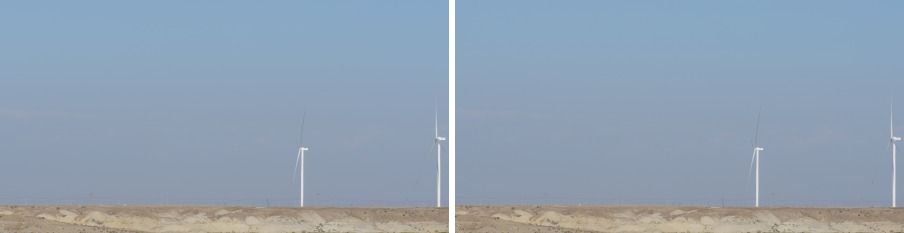

# A7R6 Looks

**中文** | [English](README.en.md)

**为索尼 A7R VI（ILCE-7RM6）逆向还原的 12 种「创意外观」——Lightroom / Camera Raw 配置文件**


-blue.svg)


> ⚠️ **Beta 声明**：本项目为个人逆向工程成果，处于**测试阶段**，**非索尼或 Adobe 官方产品**。仅供个人学习与非商业使用，**禁止商用**。还原目标是"接近机内直出观感"，不保证色度学意义上的绝对准确。

---

## 目录

- [项目背景](#项目背景)
- [包含的外观](#包含的外观)
- [设计理念](#设计理念)
- [主要特性](#主要特性)
- [安装与使用](#安装与使用)
- [效果对比](#效果对比)
- [精度验证](#精度验证)
- [工作原理](#工作原理)
- [已知局限](#已知局限)
- [参考与致谢](#参考与致谢)
- [许可证](#许可证)

---

## 项目背景

A7R VI 机型较新，Adobe 至今没有提供它的相机匹配（Camera Matching）配置文件。在 Lightroom / Camera Raw 里无论选 Adobe 颜色、Adobe 标准还是 Adobe 风景，颜色都和相机屏幕、索尼官方 IEDT 呈现的差一截——绿色偏黄、饱和度偏低。

本项目换了个思路：不去拟合"Adobe 输出 → 索尼输出"的经验曲线，而是**直接把索尼的外观链搬进配置文件**——

- 从每张 ARW 的加密 SR2 数据里读出 12 种外观的完整参数；
- 从本机安装的 Imaging Edge Edit 中定位算法所需的常数表；
- 用这套链在规则网格上求值，写成 ACR 原生的 3D 表（RGBTable）。

最终每个外观都是一份 64³ 的确定性映射，不依赖任何训练图片。


## 包含的外观

| 代号 | 名称 | 风格 |
|---|---|---|
| ST | Standard | 标准，索尼默认基调 |
| VV | Vivid | 鲜艳，高饱和高对比 |
| NT | Neutral | 中性，低饱和，适合再创作 |
| PT | Portrait | 人像，肤色柔和 |
| FL | Film | 电影感，青橙倾向 |
| VV2 | Vivid 2 | 更克制的鲜艳 |
| IN | Instant | 拍立得/哑光，抬黑 |
| SH | Soft High-key | 柔和高调，低对比 |
| BW | Black & White | 黑白 |
| SE | Sepia | 棕褐 |
| FL2 | Film 2 | 电影感二代，淡雅 |
| FL3 | Film 3 | 电影感三代，暖调 |

## 设计理念

- **算法级还原，而非拟合**：配置文件是外观链的离散化求值，参数与索尼一致，因此换场景不需要重新训练；
- **不叠加 Adobe 的色彩**：自建线性底座 DCP，把 ACR 的工作空间变成"白平衡后的相机 RGB"，避免 Adobe 自身的色彩和影调二次加工；
- **影调一步到位**：配置文件已含完整影调（曲线、褪色、饱和度分配），套上就是成片基调。

## 主要特性

- 🎨 **12 种外观齐全**：覆盖 ST / VV / VV2 / NT / PT / FL / FL2 / FL3 / IN / SH / BW / SE
- 🎯 **高还原度**：与 IEDT 导出对比，ST ΔE₇₆ 1.36、FL2 1.41（肉眼难以分辨）
- 📦 **免训练、可复现**：参数取自 ARW，常数取自本机软件，同一套代码可重新生成
- 🔧 **原生表格式**：`crs:RGBTable`（64³，ProPhoto gamma 1.8），由 ACR 直接执行
- 🧩 **即插即用**：一个底座 DCP + 若干外观 XMP，复制即可用

## 安装与使用

### 1. 下载

下载本仓库 `profiles/` 下的全部文件：`SonyA7R6 Linear Base.dcp` 与 12 个 `A7R6 *.xmp`。

国内网盘：通过网盘分享的文件：a7r6-looks
链接: https://pan.baidu.com/s/1QFSq0i5Gy9hkJWpof7zgeA?pwd=pcjs 提取码: pcjs 
--来自百度网盘超级会员v4的分享

### 2. 安装

**Windows**

```text
SonyA7R6 Linear Base.dcp  →  C:\ProgramData\Adobe\CameraRaw\CameraProfiles\
A7R6 *.xmp                →  %APPDATA%\Adobe\CameraRaw\Settings\  比如我是C:\Users\zcy\AppData\Roaming\Adobe\CameraRaw\Settings\
```

**macOS**
（目前mac使用会有不生效的问题，还在排查）
```text
SonyA7R6 Linear Base.dcp  →  /Library/Application Support/Adobe/CameraRaw/CameraProfiles/
A7R6 *.xmp                →  ~/Library/Application Support/Adobe/CameraRaw/Settings/
```

安装后**完全退出** Photoshop / Lightroom 再重启。

### 3. 使用

在基本面板的**配置文件浏览器**中选择分组 **Sony A7R6**，再选具体外观（如 `A7R6 ST`）。

- 白平衡保持**原照**；
- 配置文件已含影调，无需再套其它预设；
- 想微调可用配置文件旁的**数量**滑杆。

> 提示：本项目的配置文件是"外观 + 线性底座"成套使用的，单独拷 XMP 不拷 DCP 会报缺少配置文件。

## 效果对比

同一张 RAW，本配置文件与索尼官方 IEDT 导出的对比：



*图：左为本项目 ST 配置，右为 IEDT 直出——影调与色彩基本重合*

## 精度验证

同一批 ARW，两侧均导出 16bit/JPEG 后几何对齐，8 倍降采样，按 sRGB / D50 计算（每张取 500px 长边）：

| 场景 | ΔE₇₆ | ΔE₀₀ | 说明 |
|---|---|---|---|
| DSC00697（湖景） | 0.98 | 0.75 | 参与黑位标定 |
| DSC00737（林地） | 0.98 | 0.79 | 参与白平衡折中标定 |
| DSC00642（纪实） | 1.15 | 1.00 | **未参与标定，留出验证** |

平均 ΔE₇₆ ≈ 1.04、ΔE₀₀ ≈ 0.85。绿调密集的林地场景色度残差略高（中间调 Δa 约 −0.2），属两家去马赛克与色度处理差异，不在配置文件可控范围内。

> 说明：上述数值基于对 Camera Raw 输入编码 E 与黑位/白平衡的实测标定；换用其他 ACR 版本或大幅改动 Adobe 管线的版本，需要重新标定。

## 工作原理

```
ARW（加密 SR2）
  └─ 12 组外观 IFD：0x780f / 0x7805 / 0x7806 / 0x7842-46 ……
        │
        ▼
  外观链（逐像素）
   LinearMatrix16 → MainGamma → RGB2YCC → 分象限处理
   → ChromaSuppress → AreaComp → YGamma → YCC2RGB → Effect(BW/SE)
        ▲
        │  常数表（atan、对比度曲线族）取自本机 Edit.exe
        │
        ▼
   f_look ∘ E⁻¹  → 64³ RGBTable  → .xmp
```

- **E** 是 Camera Raw 交给配置文件的内部编码（中间调线性、高光色相保持压缩），经合成色卡标定后取逆；
- 底座 DCP 的 ColorMatrix 取自 Adobe Standard A7R6（白平衡行为与 Adobe 一致），ForwardMatrix 设为线性 ProPhoto → XYZ D50，tone curve 恒等；
- 写入的是 `crs:RGBTable` + `crs:Table_<MD5>`（base85 + zlib 私有编码），不是会被静默忽略的 `crs:LookTable`。

技术细节与常数表定位方法见 [TECHNICAL.md](TECHNICAL.md)。

## 已知局限

- **DRO / 大光比**：空间自适应处理，不属于逐像素链，配置不含；
- **锐化 / 降噪 / 清晰度**：各软件自行实现的空间处理，不由配置文件承担；
- **褪色参数**：按相机默认生成（FL2/FL3 = 1、IN = 3、SH = 6），配置内不可再调；
- **机型绑定**：参数来自 A7R6 的 ARW，其他机型请勿直接套用；
- **E 模型**：沿用针对 Camera Raw 的标定，若 Adobe 改动管线需重新标定。

## 参考与致谢

本项目的思路与外观链实现参考自以下开源项目：

- **[751K/sony-a7m5-looks](https://github.com/751K/sony-a7m5-looks)** —— 对 Sony Imaging Edge Edit 的外观链做了逐位逆向与 Python 移植（MIT License），本项目在其基础上完成了 A7R6 的参数提取、Windows 版常数表定位与 ACR 配置生成。

```text
https://github.com/751K/sony-a7m5-looks
```

## 许可证

本项目采用 [CC BY-NC 4.0](https://creativecommons.org/licenses/by-nc/4.0/deed.zh) 许可证：

- ✅ 个人学习、研究与非商业使用
- ✅ 署名前提下可自由分享与修改
- ❌ **禁止任何形式的商业使用**
- ⚠️ 与 Sony、Adobe 均无官方关联，相关商标归各自公司所有

**免责声明**：本项目按"现状"提供，不附带任何明示或暗示的保证。使用本配置文件产生的任何后果由使用者自行承担。若你所在地区对逆向工程有额外限制，请自行遵守当地法律。
