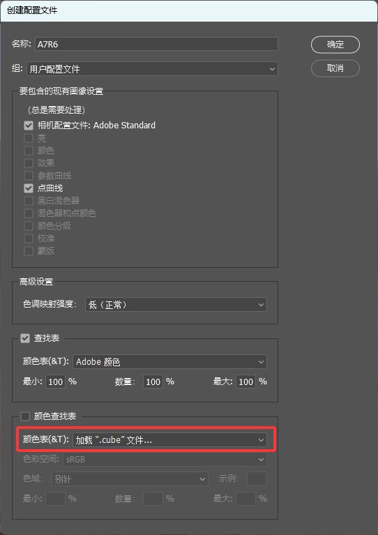
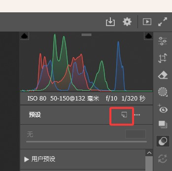
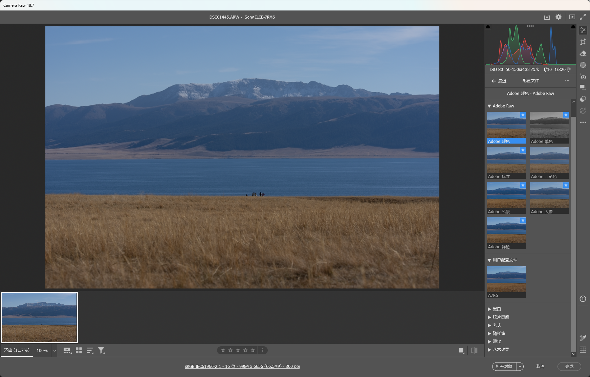
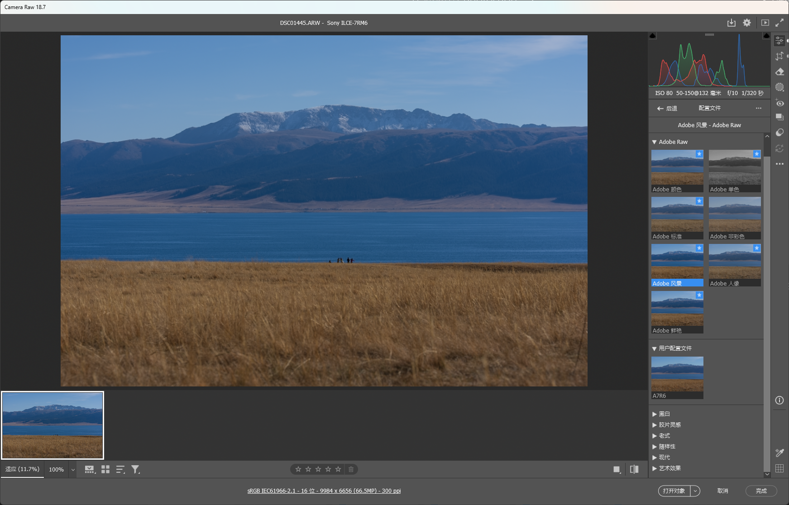
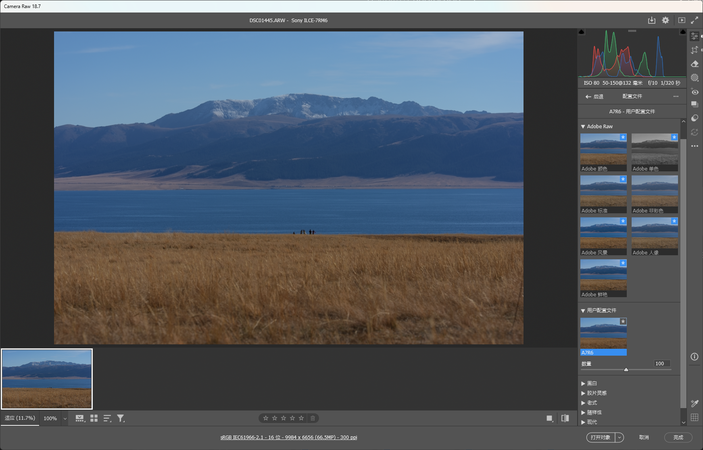
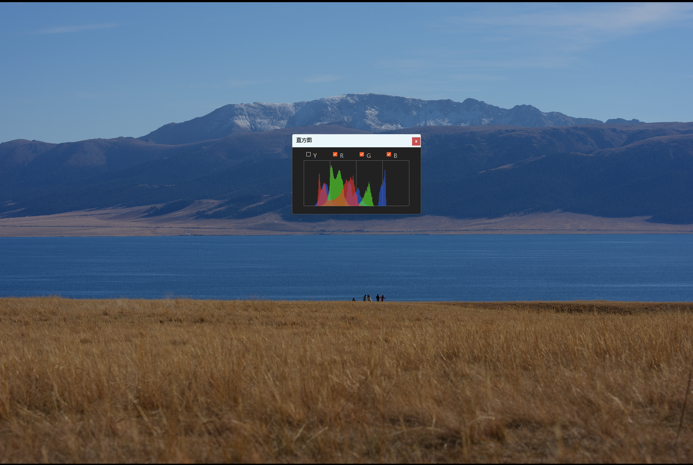

# A7R6 True ST

**逆向还原索尼 A7R VI（ILCE-7RM6）「创意外观 ST」色彩的 Lightroom / Camera Raw 配置文件**


-blue.svg)


> ⚠️ **Beta 声明**：本项目为个人逆向工程成果，目前处于**测试阶段（Beta）**，**非索尼或 Adobe 官方产品**。仅供个人学习与非商业使用，**禁止商用**。色彩还原以"接近机内直出观感"为目标，不保证色度学意义上的绝对准确。

---

## 目录

- [项目背景](#项目背景)
- [设计理念](#设计理念)
- [主要特性](#主要特性)
- [适用场景](#适用场景)
- [安装与使用](#安装与使用)
- [效果对比](#效果对比)
- [工作原理](#工作原理)
- [已知局限](#已知局限)
- [许可证](#许可证)

---

## 项目背景

索尼 A7R VI（ILCE-7RM6）机型较新，Adobe 尚未为其提供相机匹配（Camera Matching）配置文件。在 Lightroom / Camera Raw 中，无论选择 Adobe 颜色、Adobe 标准还是 Adobe 风景，解码出的颜色都与相机屏幕、索尼官方软件 IEDT（Imaging Edge Desktop）呈现的颜色差异明显——**绿色普遍偏黄，饱和度偏低**。

本项目通过黑盒采样的方式逆向索尼的色彩引擎：让 Adobe 管线和索尼官方管线分别渲染同一批 RAW，逐像素学习颜色映射关系，训练出一张 3D LUT，封装为 ACR 增强配置文件。

**装上它，你的 Lightroom 调色起点就是"索尼直出色彩"。**

## 设计理念

- **起点不歪**：调色的第一步不该是"纠偏"。本配置文件把 ACR 的解码色彩对齐到相机直出观感，之后的风格化调色都在正确的地基上进行。
- **忠实于相机，而非绝对色度**：目标是还原"你在相机屏幕上看到的那个颜色"（索尼 ST 创意外观），而非物理准确的颜色。
- **数据驱动、持续进化**：配置文件由真实拍摄样本训练而成（当前 279 个场景 / 5000 万+ 颜色样本），覆盖风光、山林、夜景、人像等题材，并可持续增量训练。

## 主要特性

- 🎨 **高还原度**：测试集平均色差 ΔE00 ≈ 1.8（< 2 即肉眼难以分辨）
- 🌲 **索尼 ST 影调**：完整还原创意外观 ST 的色彩与影调映射
- 🔧 **强度可调**：支持 ACR 配置文件的 Amount 滑杆，可微调校正力度
- 📦 **轻量分发**：单个 `.cube` 文件，安装一次，LR 与 ACR 全局可用
- 🧪 **抗瑕疵处理**：内置平滑与增益限制，天空渐变无断层、焦外过渡不生硬

## 适用场景

| 工具 | 支持情况 |
|---|---|
| Adobe Lightroom Classic | ✅ 配置文件浏览器 → 用户配置文件 |
| Adobe Lightroom (云版) | ✅ 同步后可用 |
| Adobe Camera Raw (Photoshop / Bridge) | ✅ 原生创建入口 |
| Capture One / 其他 RAW 软件 | ⚠️ `.cube` 可作为通用 3D LUT 导入，但未经适配验证 |

适用相机：**Sony A7R VI（ILCE-7RM6）**，创意外观 **ST**。理论上同代索尼机型（A7M4、A7CM2 等搭载同款处理器的机型）色彩科学相近，可尝试使用，但未经验证。

## 安装与使用

### 1. 下载

从 [Releases](../../releases) 下载 `sony_st.cube`（或直接克隆本仓库）。

### 2. 创建配置文件（推荐方式）

> ⚠️ 不要直接"导入配置文件和预设"——ACR 对 LUT 型配置文件的封装有特殊编码，官方唯一可靠入口是 Camera Raw 的"新建配置文件"对话框。

1. 在 Photoshop 中打开任意一张 **RAW** 文件，进入 **Camera Raw**；
2. 基本面板 → 右上角菜单 → **Camera Raw 默认值**（复位，避免带入旧设置）；
3. 打开**预设面板**（快捷键 `Shift + P`）；
4. **按住 `Alt` 键**，点击面板上的**"创建新预设"**按钮 → 此时弹出的就是**"新建配置文件"**对话框；
5. 填写名称（如 `A7R6 True ST`），取消勾选所有调整项，仅勾选**"颜色查找表"** → 载入下载的 `.cube` 文件；
6. **色调映射强度选择「低」**（让 LUT 全权负责影调，避免 Adobe 二次加工）；
7. 确定。配置文件即刻出现在配置文件浏览器的**"用户配置文件"**组中。



*图：Camera Raw 中通过"新建配置文件"对话框载入 .cube 文件*



*图：按住 Alt 点击这个按钮，即可打开"新建配置文件"对话框*

### 3. 日常使用

- 在 Lightroom / ACR 的**基本面板 → 配置文件**中选择 `A7R6 True ST`；
- **白平衡保持"原照"**（配置文件是在原照白平衡下训练的）；
- 可用配置文件旁的**数量（Amount）滑杆**微调校正强度（建议 90–110 之间）；
- 若 Lightroom 在创建配置文件时处于打开状态，需重启才能看到新配置文件。

> 💡 进阶：可在 Lightroom 首选项 → 预设中，将该配置文件设为本机型的**默认配置文件**，此后所有新导入的 RAW 自动以索尼色彩为起点。

## 效果对比

### Adobe 各配置文件 vs 本配置



*图：Adobe 颜色（默认）解码效果——饱和度偏低*



*图：Adobe 风景解码效果——饱和度有所提升但湖面和山体阴影偏青*



*图：应用 A7R6 True ST 后——色彩与影调对齐索尼直出观感，略偏青*

### 与索尼官方 IEDT 渲染对比



*图：左/中为应用本配置文件的 ACR 渲染，右为索尼官方 IEDT 渲染——平均色差 ΔE00 ≈ 1.8*

## 工作原理

```
同一批 RAW 文件
      │
 ┌────┴────┐
 ▼         ▼
ACR 渲染   索尼官方渲染
(归零基准)  (机内 JPEG / IEDT)
 │         │
 └────┬────┘
      ▼
逐像素颜色配对（279 场景，5000 万+ 样本）
      ▼
Delaunay 插值 → 32³ 3D LUT（.cube）
      ▼
平滑 + 增益限制后处理
      ▼
ACR"新建配置文件"封装 → Lightroom 可用
```

技术要点：

- 参考侧直接使用 **RAW 内嵌的机内 JPEG**（经实测与 IEDT 渲染平均 ΔE ≈ 0.6，几乎无损一致），使全库自动化训练成为可能；
- 采样经网格去重、凸包内 Delaunay 线性插值、凸包外 RBF 平滑外推；
- 后处理包含全局/暗部平滑（抗马赫带、压 8bit 参考噪声）与局部增益限制（防止焦外微反差被放大成斑块）；
- 每次增量训练都在固定测试集上考核泛化能力，劣化版本直接淘汰。

## 已知局限

- **DRO / 大光比场景**：索尼的动态范围优化是空间自适应操作，LUT 无法完整拟合，大光比暗部仍可能有可见残差；
- **未覆盖题材**：训练集未出现的颜色类型（如特定人造光源）精度相对较低；
- **非色度学校准**：本项目还原"观感"，如需物理准确的颜色请使用色卡 + DCP 配置文件方案；
- **机型绑定**：基于 A7R VI + ST 创意外观训练，其他机型/其他创意外观（VV、FL 等）需重新训练。

## 许可证

本项目采用 [CC BY-NC 4.0](https://creativecommons.org/licenses/by-nc/4.0/deed.zh) 许可证：

- ✅ 个人学习、研究、非商业使用
- ✅ 署名前提下可自由分享与修改
- ❌ **禁止任何形式的商业使用**
- ⚠️ 本项目与 Sony、Adobe 无任何官方关联，相关商标归各自公司所有

**免责声明**：本项目为个人逆向工程的实验性成果，按"现状"提供，不附带任何明示或暗示的保证。使用本配置文件产生的任何后果由使用者自行承担。
